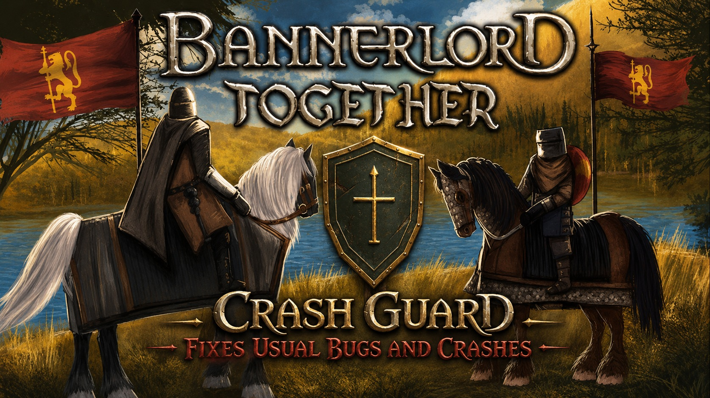

<p align="center">
  
</p>

<h1 align="center">Bannerlord Together Crash Guard</h1>

<p align="center">
  Crash protection and host-controlled compatibility adapters for <strong>Bannerlord Together</strong> co-op.
</p>

<p align="center">
  <a href="https://github.com/Enes-Balaban17/BannerlordTogetherCrashGuard/releases/latest">Download the latest release</a>
  · <a href="WORKSHOP.md">Steam Workshop publishing</a>
  · <a href="INVESTIGATION.md">Technical notes</a>
</p>

## What it fixes

**v0.5.1 fixes the v0.5.0 campaign-load crash.** Finance hooks now wait for the campaign game/text manager instead of initializing the native finance class at the main menu. Restart Bannerlord after updating. Startup lifecycle, compilation, installed-binary hook bindings and managed regression checks pass; live co-op validation of the development features below remains pending. Keep a separate backup of your campaign before testing.

### New in v0.5.0

- **Personal banking:** each authenticated co-op character has a separate account ledger saved by the host. The host validates deposits/withdrawals and applies each request once. Successful bank transactions pause the campaign and request BT save-resync; idle play does not schedule resyncs. Host native accounts are preserved. New client ledgers start empty because copied old client balances cannot be safely attributed. Client loan quests are not supported; native loans remain host-only.
- **Clan and co-op armies:** press **Alt+A on the campaign map**, outside settlements/battles. Choose **Call my clan parties** to call an available NPC companion/family party without a kingdom; repeat to call others. Other humans use their own Alt+A menu to join, leave or disband their army. A distant joining player travels to the leader; choose **Merge with my army leader** once nearby. `btcg.army` is a console alternative. Player membership uses native BT authentication and networking. Independent same-clan armies do not spend kingdom influence or lose cohesion.
- **Battle death protection:** invalid visual state skips BT's synthetic hit and lets its existing death fallback continue. A null reference in that replay method is contained and logged. This is targeted managed protection, not a guarantee against all battle or native-engine crashes.
- **Settings:** in addition to explicit adapters, annotated scalar options from discovered MCM global settings are transferred on join, manual Sync and changes. Arbitrary non-MCM configs, complex dropdown/object settings and settings that require restarting a mod are not universally supported. Existing normal movement/battle packets continue at every speed.

Full compatibility/setting refreshes are event-driven: player join, explicit native BT save-resync, or supported host setting changes. There is no periodic full/settings publish or periodic settings scan. Settings property notifications/setters and known config save/reload commands mark changes; unobservable direct edits to another mod's private fields require explicit Sync. A small connection check remains, and essential native movement/battle networking, daily finance and explicit equipment/character edits continue to deliver their own event packets.

NPC/crafted-item refreshes use editor/registration events and batched join/Sync snapshots. Additional full kingdom reconciliation runs only on explicit Sync. This removes this mod's recurring snapshot work; it does not disable Bannerlord Together's necessary world/battle networking or guarantee that all game stalls are fixed.

| New adapter | Implemented behavior |
| --- | --- |
| Xorberax's Legacy | Separate host-persisted personal ledgers for clients; authoritative account opening, deposits, withdrawals and closing, zero interest on an empty account, and transaction-triggered save-resync. Host native accounts/loans are preserved; client loan quests are blocked. Existing camera protection remains. |
| BetterTime | Shares the host's fast-forward multiplier; client requests follow native time-control permission. Extra Fast requests native fast-forward mode and reports the accepted multiplier with a `[BT] Speed` message. |
| Campaign Tweaks | Shares runtime settings and host companion/workshop limits in native shared-clan mode. |
| Improved Garrisons | Shares global/settlement settings, training templates and host patrol/recruiter projections at join/Sync/settings refresh. No recurring projection snapshot loop. Host runs the simulation; full remote management commands are not implemented. |
| Diplomacy | Keeps native relation/event networking and reconciles full kingdom state on explicit Sync; suppresses duplicate client-side daily diplomacy simulation. Guards missing-geography valuation and unsafe messenger entry. This does not synchronize every Diplomacy feature. |
| Modular Smithing 2 | Shares host crafting settings and crafted item definitions, including definitions using installed Bahamut donor items. All players still need the same item assets. |
| Character Reload | Relays body, name, culture, race, level, skills, attributes and battle equipment IDs/modifiers for existing NPC heroes; refreshes native player appearance broadcasts. Perks, traits and focus editing are not fully covered. |
| Custom Cultures / Custom Starting Loadout | Stores culture profiles by authenticated player identity and applies culture feat overrides to remote player projections. Tracks initial loadout per character slot. |
| DismembermentPlus | Relays host dismemberment visuals for synchronized battles, avoids independent client rolls and co-op slow motion, and logs failures instead of opening a blocking error box. |
| Together Lords | Keeps this mod's extension packets out of Together Lords' packet dispatcher. This is transport coexistence, not a replacement for its synchronization. |

Additional development features:

- **Village battle transitions:** extends deployment/teardown tracking to village encounters and holds campaign simulation casualties while a linked player battle is pending. Intentional autoresolve remains available.
- **Battle rewards:** divides the host's newly earned items, gold and ordinary prisoners among compatible participating players through Bannerlord Together's native reward flow. A captured lord uses the existing hero object and one assigned recipient; no hero copies are created. Disconnection, ransom, escape and multi-lord battles still need live testing.
- **Shared clan income:** pools the clan's settlement income, connected humans' workshops and caravans, and passive trade-agreement/tribute receipts already provided by the active clan finance model. Tribute means the clan's normal share, not the entire kingdom treasury. Both host-owned and client-owned assets contribute. Canonical workshop and caravan IDs prevent duplicate collection, and pooled caravans do not also receive BT's private owner income payout. The common gross pool and host-authoritative garrison funding total are divided among connected compatible humans. Personal party and other local expenses remain separate, so net gold can differ or be negative. Native daily payment targets the local human on a shared-clan client. This assumes all participants share the host clan; owner projection, daily timing and balance replay still require live verification.
- **Encyclopedia:** hides dead co-op projection heroes identified during despawn or by exact native log evidence. Real heroes are retained, not deleted. Old copies without log evidence require explicit identification.
- **Clan lifecycle:** prevents reserved BT projection clans and clans with living human-player evidence from being destroyed during co-op cleanup, and filters false projection/living-player extinction notifications. Captivity does not imply death. Genuine NPC extinction and single-player notifications remain active; previously saved damage is not automatically undone.
- **Autonomous companion equipment:** host-controlled upgrades for NPC companions leading their own parties, including companions in connected co-op players' clans. Uses their own party inventory/loot and town stock; returns replaced equipment to their party inventory. Preserves weapon/ammunition layouts and mount families, checks skill/sex restrictions and gives a small culture preference. Only battle equipment changes; player-controlled heroes and banners are excluded. At most two market purchases per daily attempt, spending at most 10% of the companion's own gold (20,000 cap) while retaining 1,000. Work is queued in small candidate batches, not a recurring all-hero scan. `btcg.companion_equipment off` / `on` lets the host stop/resume it. Inventory, merchant payment and remote party ownership still need live co-op testing.

Companion item ranking adapts the MIT-licensed `ItemRanking`, `ItemView` and `ItemCategory` from [CompanionManagementSuite](https://github.com/Else123/CompanionManagementSuite), copyright Elias Elsner. The original license is included in `licenses/CompanionManagementSuite-MIT.txt` and the installed module. The full upstream mod is not required or bundled.

The messenger adapter addresses unsafe conversation entry conditions; it is not proof that every reported native freeze or crash has been resolved. Include a fresh crash report if it reproduces.

- **Empty village battle.** The quest raid's campaign state stays available while Bannerlord spawns the player and both armies.
- **Crash when leaving the battlefield.** The raid stays protected through agent cleanup. If a troop's campaign entry is missing at cleanup, the patch uses the mission character to preserve a living hero's health and lets the game finish closing the mission.
- **Deployment fallback.** On a Bannerlord Together gameplay host, the patch catches nonfatal managed exceptions from deployment setup and completion. If the battle opens with missing troops or a missing player, it records a `BROKEN_START_…` entry. This fallback can leave the battle unplayable.
- **Xorberax Shoulder Camera compatibility.** During a co-op transition with no current mission, Xorberax uses the normal camera instead of reading the missing mission clock. The hook activates when the compatible Xorberax package is loaded.
- **Leaving captivity in co-op.** The relocation search handles nearby parties without a faction. If relocation still throws a null reference during local player release, native captivity cleanup continues.

## Compatibility

| Component | Target |
| --- | --- |
| Mount & Blade II: Bannerlord | **v1.4.8.119303** on Windows x64 |
| Bannerlord Together | **v0.5.0.1**, Steam Workshop build |
| Harmony | **v2.4.2.248** |

The original spawn fix was confirmed in a host session. The exit fix and renamed release passed the Windows .NET Framework patch-binding tests. A replay of the affected quest exit and a two-player regression test remain open.
The v0.2.4 camera hook was tested for binding with Xorberax’s Legacy **v1.0.8.8**. The two new fixes still need a live co-op replay.

## Install

**Recommended:** download `BannerlordTogetherCrashGuard-v0.5.1-Setup.exe` from [Releases](https://github.com/Enes-Balaban17/BannerlordTogetherCrashGuard/releases/latest), run it, and select the Bannerlord game folder. The installer includes the mod payload/license, automatically removes the installed module files' Windows download block (`Zone.Identifier`), and keeps a backup of an existing installation. No separate PowerShell or DLL-unblock step is needed. It only unblocks this mod's installed files; it does not change other mods or Windows security settings.

1. Extract the release ZIP into the Bannerlord installation. The launcher manifest should be at `Modules\BannerlordTogetherCrashGuard\SubModule.xml`.
2. In **Singleplayer → Mods**, enable **Bannerlord Together Crash Guard** below **BannerlordTogether**. Keep **BLT Deployment Crash Guard** disabled.
3. Install **the same v0.5.1 build on the host and every client**, with the same optional mod versions and asset packs. Missing optional mods are skipped. Run the setup executable if you prefer installation without manual PowerShell commands.
4. If upgrading from **BLT Village Battle Fix**, remove the old copy from `Modules` and enable the new entry. Because the module ID changed in v0.2.3, an existing save may show the former module as missing. Starting with v0.3.0, compatibility identities and reward/projection bookkeeping are stored as campaign save data.

For older dead encyclopedia duplicates, use the developer console to list exact IDs with `btcg.find_dead_heroes <name>`, then hide only the unwanted IDs with `btcg.hide_dead_heroes <id> [more ids]`. This hides entries and preserves the underlying save objects.

## Logs

Open `%LOCALAPPDATA%\BannerlordTogetherCrashGuard\battle.log`.

| Log entry | Meaning |
| --- | --- |
| `Loaded v0.5.1` | Harmony patches loaded |
| `Inactive: Unsupported … SHA-256` | Installed binary differs from the supported build |
| `[DEPLOY-GUARD] BROKEN_START_…` | Deployment exception was caught and spawn checks found a problem |
| `[QUEST-RAID-EXIT] completed` | Mission cleanup returned. Check the quest result on the campaign map. |
| `[SHOULDER-CAMERA] Used normal camera` | Xorberax skipped the ranged camera adjustment during a co-op transition |
| `[CAPTIVITY-EXIT]` | Relocation encountered missing faction data or failed before release cleanup completed |
| `[COOP-COMPAT]` / `[HOST-SETTINGS]` | Compatibility handshake, state/settings application, or an optional adapter failure |
| `[MESSENGER]` | Remote conversation opened, postponed, declined or failed |
| `[LOOT-SHARE]` | Reward allocation, unique lord assignment, or a failed transaction |
| `[VILLAGE-SIMULATION]` | Casualty simulation held while a linked village mission is pending |
| `[CLAN-INCOME]` | Actual gross income, assigned share and native daily net transfer |
| `[COMPAT-PERF]` | A compatibility publish took at least 20 ms; rate limited to help diagnose remaining stalls |
| `[CLAN-LIFECYCLE]` | Destruction of a living player/reserved projection clan was prevented |
| `[COMPANION-EQUIP]` | Actual NPC equipment swap, personal market payment or an upgrade failure |

When reporting an issue, include the game and mod versions and the relevant section of the log. Remove personal details before posting logs publicly.

## Build from source

PowerShell with an x64 .NET SDK and the target game and mods installed.

```powershell
.\build.ps1 -GameDir "D:\SteamLibrary\steamapps\common\Mount & Blade II Bannerlord" -SmokeTest
```

Use `-HarmonyBin` and `-TogetherBin` if the dependency DLLs are outside the expected Steam Workshop layout. The build creates a release ZIP in `dist`. The smoke test checks Harmony bindings, the captivity IL replacement, and deployment diagnostic classifications without starting the game. Pass `-XorberaxBin` with the folder containing `XorberaxLegacy.dll` to exercise the optional camera hook too.

Add `-CompatibilityTest` to exercise all optional bindings, packet validation, empty-account regression, configuration restoration and reward conservation. This check requires the optional mods in the local Steam/game layout; it does not start Bannerlord.
